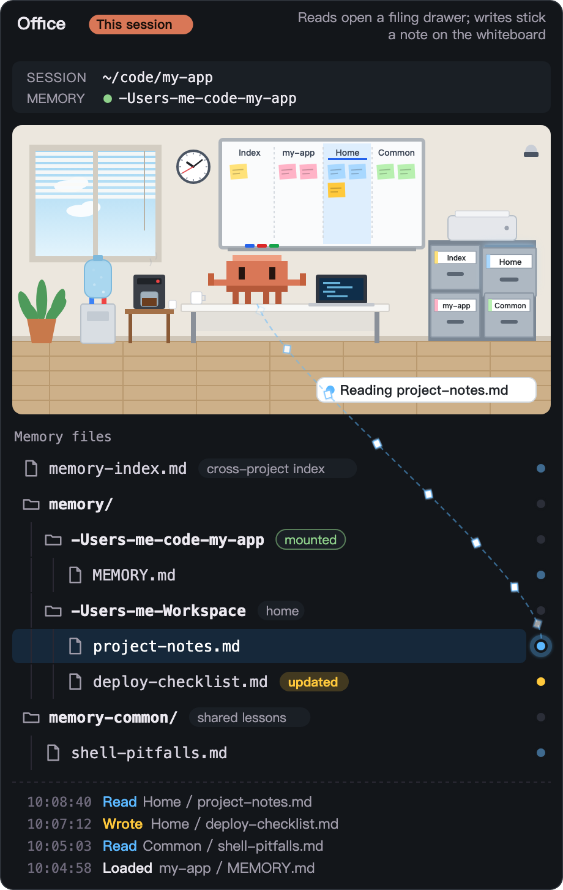
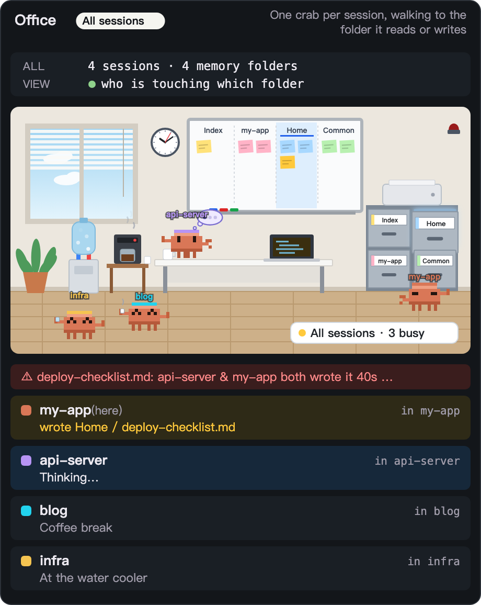
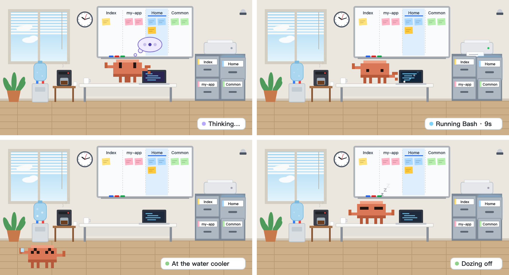

# clawd-memory

A Claude Code mod that turns Claude's memory into a little office. A pixel crab (Clawd) sits at a desk,
and every time Claude reads or writes a memory file you see it happen: a filing drawer opens, a note
goes up on the whiteboard, and a line lights up from the crab to the file.

Open the **All sessions** view and every Claude Code session on your machine gets its own crab, so you can
see at a glance who is reading which memory folder, who is thinking, and who is on a coffee break.

<p align="center">
  
  &nbsp;
  
</p>

## Why

- **Did it actually read that?** When Claude repeats a mistake you wrote a memory about, the pane shows
  whether it ever opened that file in this session, or whether the session started in the wrong folder.
- **Two sessions, one file.** If two sessions write the same memory file within two minutes, a red light
  flashes and you get a notice, since one write may silently overwrite the other (for example on a synced
  drive).
- **Memory housekeeping.** Every read and write is logged per day, so you can see which memories are used
  and which never are.

## What the crab does

| State | In the office |
| --- | --- |
| Reading memory | The drawer for that folder opens and glows; a line runs from the file to the crab (paper floats up) |
| Writing memory | The crab hops, a sticky note is added to the whiteboard, the file is marked *updated* |
| Thinking | Paces on the desk with a thought bubble (`…`, sometimes `?`) |
| Running a tool | Types on the laptop; if one tool runs over 6 s, the printer starts printing |
| Idle | Stretches, then after 30 s walks to the water cooler, after 2 min has coffee, after 8 min dozes off |

<p align="center">
  
</p>

In **All sessions** the crabs walk to the filing cabinet of the folder they read or write. That view
knows whether another session is mid-turn, but not which tool it runs, so busy sessions show as thinking.

## How it works

Each session that loads the mod appends one JSON line to `~/.claude/clawd-memory/events-YYYY-MM-DD.jsonl`
when it reads or writes a memory file (`tool.call`), when memory is loaded at the start of a prompt
(`prompt.context`), and when a turn starts or ends. The pane checks that file every 2 seconds and only
rereads it when it changed. Nothing is sent anywhere, and the mod uses no model calls, so it costs no
tokens.

A path counts as memory when it is under one of:

- `~/.claude/projects/<folder>/memory/` (Claude Code's own memory)
- `…/claude-shared/memory/<folder>/`, `…/claude-shared/memory-common/` and `…/claude-shared/memory-index.md`
  (a shared layout, for memory kept in a synced folder)

Reads and writes through Read, Edit, Write and friends are exact. Through Bash the mod guesses: a command
with `>`, `tee`, `sed -i`, `mv`, `cp`, `rm` and the like counts as a write, anything else as a read.

## Setup

1. Load the mod:
   - Terminal: `claude --plugin-dir /path/to/clawd-memory`
   - Desktop app: add the folder to `CLAUDE_CODE_PLUGIN_DIRS` in the `env` block of
     `~/.claude/settings.json` and start a new session (separate several folders with `:`):

     ```json
     { "env": { "CLAUDE_CODE_PLUGIN_DIRS": "/path/to/clawd-memory" } }
     ```

   For **All sessions** to show other sessions, they need the mod too, which the `env` block gives every
   new session.
2. Open the pane with `/clawd`, or `/clawd all` for every session. The buttons above the office switch
   between the two views.
3. Options (optional) go in `~/.claude/settings.json` under `pluginConfigs.clawd-memory.options`:

   | Option | Default | Meaning |
   | --- | --- | --- |
   | `language` | `auto` | `auto` (follows `LANG`), `en`, `zh-TW` |
   | `default_view` | `session` | `session` or `control` (all sessions) |

The office is drawn as SVG, so it needs the desktop app or another surface that draws images; in a
terminal the pane falls back to text. It animates at 8 frames a second while something happens and 4 while
idle, and only while the pane is in view.

## Development

```bash
claude plugin validate .
claude plugin test .
```

| File | What it holds |
| --- | --- |
| `.claude-plugin/plugin.json` | Manifest and options |
| `hooks/register.tsx` | Hooks, the shared event file, the scene and the pane |
| `hooks/office.ts` | The drawings: office, crab sprites, props, the whole card |
| `hooks/memory.ts` | Memory path matching, event parsing, double-write detection |
| `hooks/i18n.ts` | English and Traditional Chinese text |
| `types/index.d.ts` | `$.state` contract |
| `tests/clawd-memory.test.ts` | Plugin tests |

## License

MIT
